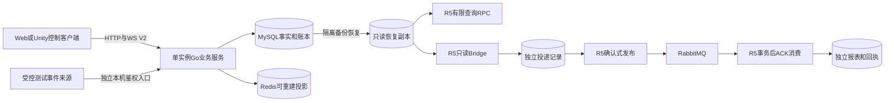

# 当前系统架构

当前支持V2／GM业务基础和独立R5实验，legacy只作历史兼容。设计与维护边界见[维护说明](maintenance/README.md)。

## 主业务所有权

MySQL保存账号、Party、票据、Proposal、Run、事实序列、任务、pending／outbox、奖励与资产账本。Redis保存队列、在线和奖励展示等可重建投影；它不是唯一发奖依据。WebSocket连接只属于当前进程。

同库named lock保证只运行一个业务写实例；复制Go进程不能直接水平扩容。连接中断、旧代次和重复意图分别检查。业务事务中写入Outbox，发布状态提交后再尝试通知；推送仍可能丢失，客户端查询当前活动／结果恢复，不能承诺通知恰好收到一次。

逐人结算在事务内保护参与者结果、唯一奖励来源、余额和流水；失败后处理尚未完成的记录。Worker只分派明确支持的类型，完成／失败更新必须匹配选中尝试，维修与新计划不能被旧结果覆盖。

## R5的两条独立读链

RPC直接查询隔离恢复副本的有限视图，奖励榜是该实验定义的累计奖励口径。MQ消费者将报告写入独立报表库；RPC并不通过消费者的报表查询。源恢复版本和保留历史范围有界，不称实时CDC或无限重放。

运行角色只获得必要配置并按需连接依赖：rpc只读来源，bridge读来源并写投递状态，publisher／consumer连接报表库和各自MQ身份。共享数据库账号的表级权限没有因配置拆分自动变成每角色完全隔离。

## 默认环境与故障边界

新本机入口只创建自己拥有的隔离安装，18080／33306／36379绑定loopback。Existing Check不创建表、迁移或Redis键；Existing Server会执行正常业务恢复，需操作者明确选择。旧数据库和凭据不自动轮换。

R5原实验保持独立端口、独立合成恢复库、服务身份和报表库。全部角色在同机／单节点范围，停止实验不影响主奖励链路；不能把这种依赖隔离称为集群高可用。公网、真实DS、多实例和调度不在本仓库维护范围。

历史架构与当时成绩见Git基线401247d及[阶段总结](phase2-summary.md)。旧文档中先叙述legacy再追加V2的结构不再作为当前架构入口。
